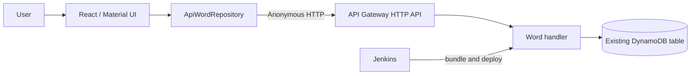

# System architecture

Status: persistence is implemented in source; authentication is temporarily unplugged and tested locally. Production configuration, deployment, and a live browser-to-DynamoDB round trip remain unverified.

The browser loads a paginated dictionary, fetches selected entries, and creates/updates/deletes words through the API. There is no mock-data fallback. Written forms, readings, senses, components, tags, and timestamps travel as one WordEntry aggregate. Editor drafts stay local until a successful response replaces them with server data.

The table is a shared dictionary with a string partition key named id and no sort key. There is currently no application authentication or ownership enforcement. The retained OAuth module is disconnected. Existing API Gateway authorizers must be disabled separately for anonymous access.

[Persistence](persistence.md) describes HTTP contracts, conditional writes, auth, and setup. [Data model](data-model.md) describes invariants. [Roadmap](../roadmap/index.md) distinguishes implemented source from outstanding rollout and product work.

Jenkins installs both dependency sets, runs tests and frontend build, typechecks/bundles the backend, packages lambda.zip, and updates the configured Lambda. The optional SAM template describes a new API/Lambda around an existing table and identity provider; it does not adopt existing cloud resources or deploy automatically.
