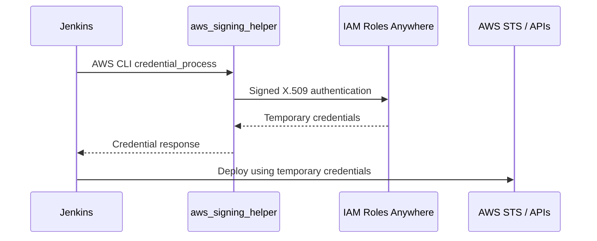

# AWS Authentication for Jenkins

## Roles Anywhere

Jenkins runs outside AWS and authenticates with an X.509 certificate via AWS IAM Roles Anywhere. The signing helper obtains temporary credentials for an IAM deployment role, avoiding long-lived AWS access keys.

## Previously verified

The credential helper configuration and `aws sts get-caller-identity` were reported working. Earlier notes used profile names `jenkins-pipe` and `jenkins-deployment` at different stages; **check the actual AWS config** rather than assuming either is definitive.

## Security controls

- Mount certificate and private key as protected secrets, not committed files.
- Scope trust policies to the intended trust anchor and certificate identity.
- Separate deployment IAM role from Lambda execution role.
- Grant only the deployment actions and resource ARNs needed.
- Rotate certificates and document expiration monitoring.

Do not publish private keys, full credentials, or sensitive environment output in these docs.

